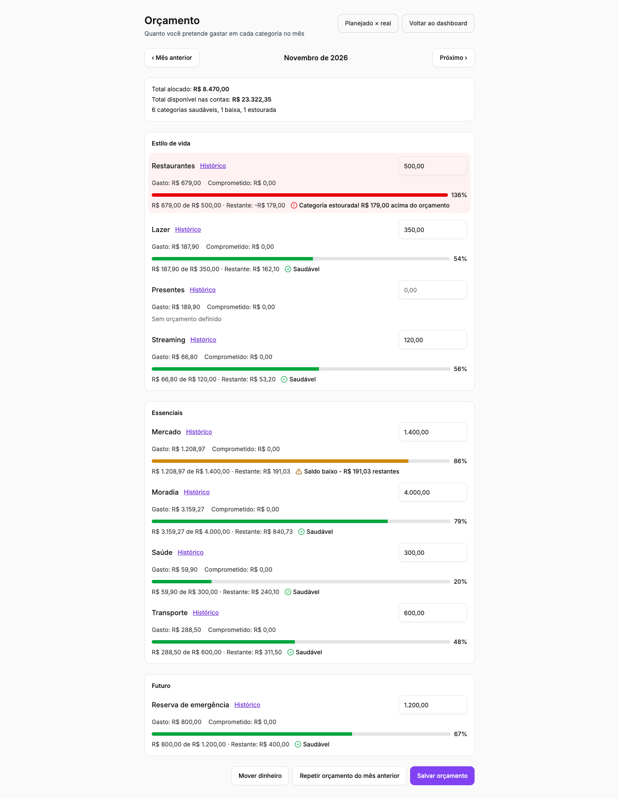
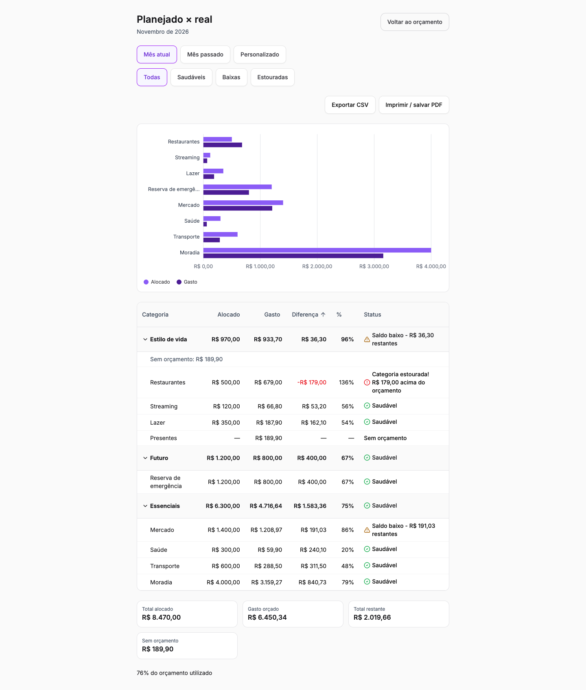
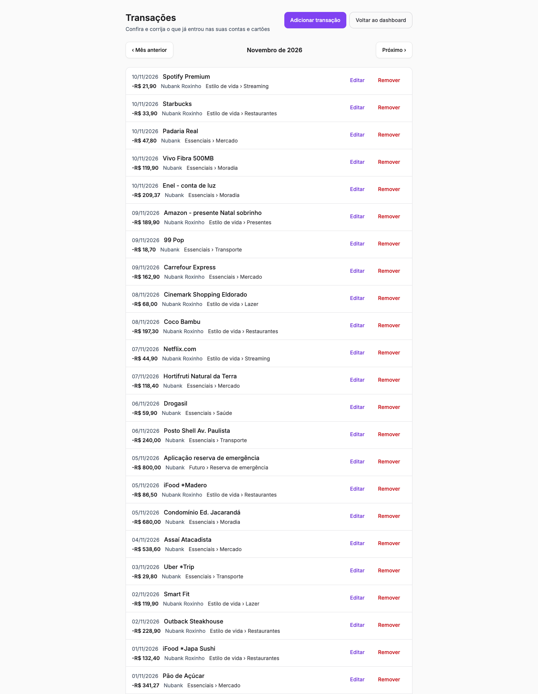
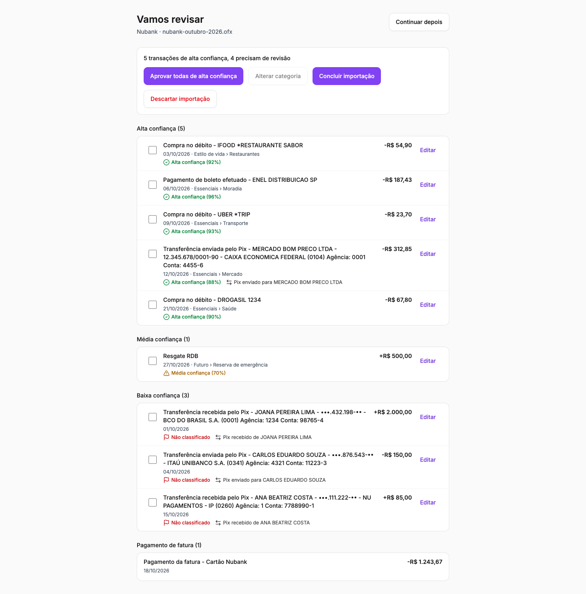
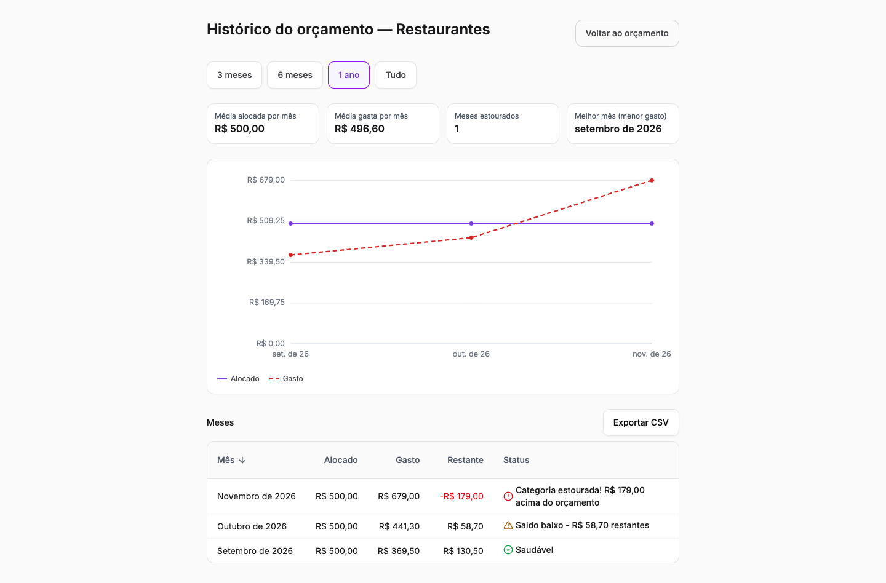
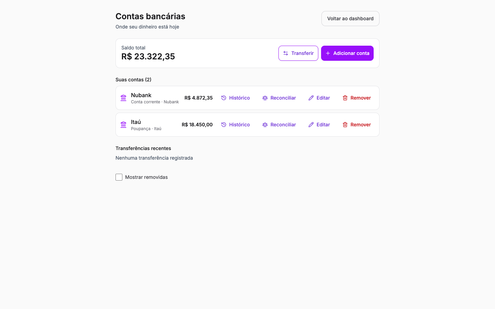
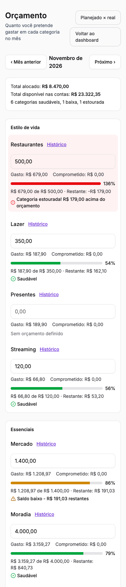

# Porquinho

Personal finance app for Brazilian users, built around **envelope budgeting**: every real of income gets a job, spending is tracked against each envelope in real time, and bank statements are imported and classified by AI instead of typed by hand.

The UI is in Brazilian Portuguese; the code, commits and docs are mostly in English and Portuguese.



## Features

**Budgeting (envelope method)**
- Category groups with child envelopes, monthly allocation per envelope and real-time available balance
- Move money between envelopes, with the rules of the method enforced (no moving more than is left)
- Healthy / low / overspent indicators, always with icon + text (not color alone)
- Allocation history per category and a planned × actual comparison over any period of up to 12 months, with CSV export and print

**Bank statement import**
- OFX and CSV statements from Nubank, Itaú, Bradesco, Caixa and Banco do Brasil, with automatic format and bank detection
- Duplicate detection, PIX identification (payer/payee extraction) and installment purchases split across future months
- AI classification of each transaction (Claude, via the Anthropic API) with a confidence score, a review screen, and learning from the user's corrections

**Accounts and transactions**
- Multiple bank accounts and credit cards, internal transfers, reconciliation with the bank balance and balance history
- Manual transactions (cash expenses) and editing of any transaction; recategorizing an installment also moves its future installments

**Platform**
- Sign up with e-mail/password or Google, active session management and remote logout
- 30-day free trial, then a monthly subscription through Stripe Checkout, with webhooks, retries and self-service cancellation/reactivation
- LGPD (Brazil's data protection law): full data export and permanent account deletion
- Guided onboarding that sets up accounts, cards, categories and a first import
- WCAG 2.1 AA as a baseline: keyboard navigation, focus management, 44px touch targets, screen-reader labels on charts

## Screenshots

| Planned × actual | Transactions |
|---|---|
|  |  |

| Import review (AI classification) | Category history |
|---|---|
|  |  |

| Accounts | |
|---|---|
|  | |

<p align="center"></p>

All screenshots use a demo account with fictitious data.

## Tech stack

| Layer | Technologies |
|---|---|
| Frontend | Vue 3, TypeScript, Vite, Tailwind CSS, shadcn-vue, Vue Router, Vitest, Playwright |
| Backend | Java 21, Spring Boot 3.5, Spring Security (OAuth2 resource server), Spring Data JPA, Flyway |
| Data | PostgreSQL (Supabase), Redis (cache and rate limiting) |
| Integrations | Supabase Auth, Stripe, Anthropic API, Resend (SMTP) |
| Infra | Docker, nginx, GitHub Actions, Testcontainers |

## Architecture

```
            ┌──────────────┐   sign in / sign up / OAuth   ┌───────────────┐
 Browser ──►│ Vue 3 SPA    │ ─────────────────────────────►│ Supabase Auth │
            └──────┬───────┘   JWT (ES256)                  └───────┬───────┘
                   │ REST /api/v1 + Bearer JWT                      │ JWKS
                   ▼                                                ▼
            ┌──────────────────────────────────────────────────────────────┐
            │ Spring Boot API                                              │
            │  Controller → Service → Repository (JPA)                     │
            │  validates the JWT against Supabase's JWKS                   │
            └───┬───────────────┬──────────────────┬───────────────┬───────┘
                ▼               ▼                  ▼               ▼
           PostgreSQL         Redis            Stripe        Anthropic API
           (Flyway, RLS)   (cache, locks)   (billing +      (transaction
                                              webhooks)      classification)
```

- **Supabase owns authentication** (passwords, e-mail verification, Google OAuth, token issuing). The backend never sees a password: it validates the asymmetric JWT through the issuer's JWKS and keeps its own `users` table for business data, audit logs, login lockout and rate limiting.
- **The backend owns everything else**, behind a strict Controller → Service → Repository layering. The database is reached only by the backend over JDBC; row-level security is enabled on every table and the Supabase Data API roles have no grants, so the public API cannot read app data.
- **Money** is `DECIMAL(15,2)` end to end, compared with `compareTo`; the frontend formats and parses BRL in one place.
- **One transaction core** is shared by import, manual entry and editing, so balance, budget and installment rules are applied the same way on every path.
- **Budget balances are computed, not stored**: spending is derived from confirmed transactions on read and cached in Redis per user, invalidated after each write commits.

## Getting started

### Prerequisites

- JDK 21, Node.js 20.19+ or 22.12+, Docker (for Redis and the backend tests)
- A Supabase project (Postgres + Auth). Stripe, Anthropic and SMTP keys are optional for local development: without them, checkout, AI classification and e-mails are disabled.

### 1. Redis

```bash
docker run -d --name porquinho-redis-dev -p 6379:6379 redis:7-alpine
```

### 2. Backend

```bash
cd porquinho-backend
cp .env.example .env      # fill in the Supabase database URL, user, password and JWT issuer
bash run-dev.sh           # loads .env and starts Spring Boot on :8080 (profile dev)
```

Flyway applies the migrations on startup. Use the Supabase **session pooler** connection string (the direct host is IPv6-only).

### 3. Frontend

```bash
cd porquinho-frontend
cp .env.example .env      # Supabase URL, publishable key and the API URL
npm install
npm run dev               # http://localhost:5173
```

### Environment variables

| Variable | Where | Purpose |
|---|---|---|
| `SUPABASE_DB_URL`, `SUPABASE_DB_USERNAME`, `SUPABASE_DB_PASSWORD` | backend | PostgreSQL connection (JDBC URL of the session pooler) |
| `SUPABASE_JWT_ISSUER_URI` | backend | `https://<project>.supabase.co/auth/v1`; the JWKS is discovered from it |
| `SUPABASE_PROJECT_URL`, `SUPABASE_SERVICE_ROLE_KEY` | backend | Supabase secret key, used only to delete the auth user on account deletion |
| `REDIS_HOST`, `REDIS_PORT`, `REDIS_PASSWORD` | backend | Redis |
| `STRIPE_SECRET_KEY`, `STRIPE_WEBHOOK_SECRET`, `FRONTEND_URL` | backend | Subscription checkout and webhooks |
| `ANTHROPIC_API_KEY` | backend | AI classification of imported transactions |
| `SMTP_*`, `MAIL_FROM` | backend | Transactional e-mail |
| `VITE_SUPABASE_URL`, `VITE_SUPABASE_ANON_KEY` | frontend | Supabase project URL and **publishable** key |
| `VITE_API_BASE_URL` | frontend | Backend URL |

## Tests

```bash
cd porquinho-backend && ./mvnw test        # ~1,200 tests; integration tests run on PostgreSQL via Testcontainers
cd porquinho-frontend && npm run test:unit # ~760 Vitest tests
cd porquinho-frontend && npm run lint && npx vue-tsc --build
```

GitHub Actions runs the backend and frontend pipelines on every push to `main`.

## Production

`docker-compose.yml` builds the frontend and backend images and runs them behind nginx (TLS, security headers, `/actuator` blocked from outside) with Redis. The backend container runs as a non-root user.

## Project status

Done: foundation, authentication and LGPD, subscription billing, onboarding, accounts and cards, statement import with AI classification, and envelope budgeting.
Next: the dashboard, financial goals, reports and admin tooling.
